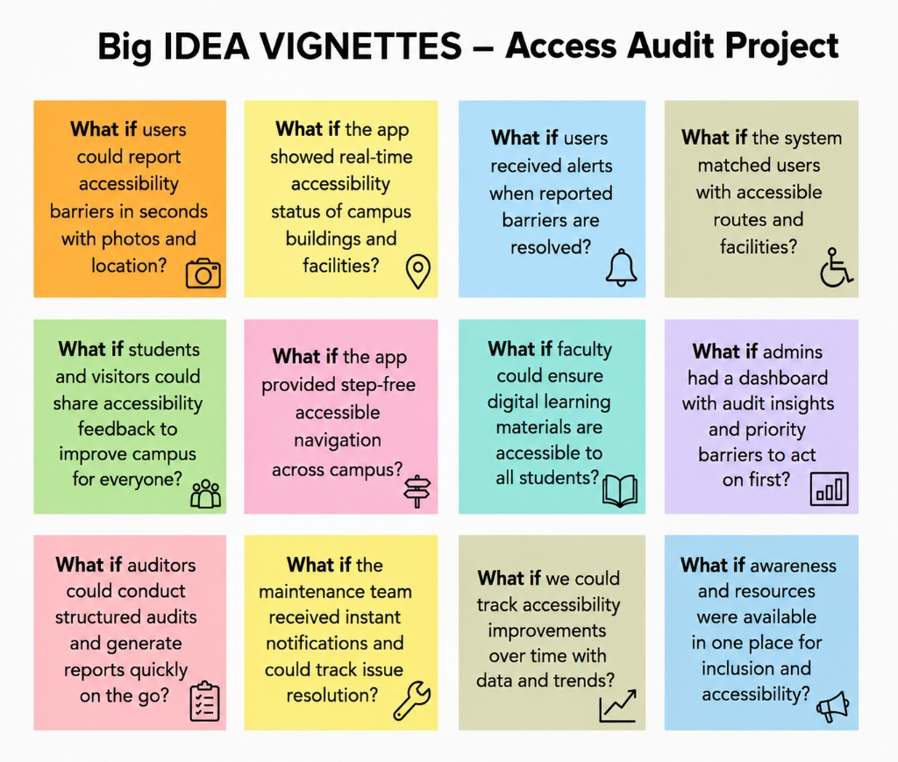
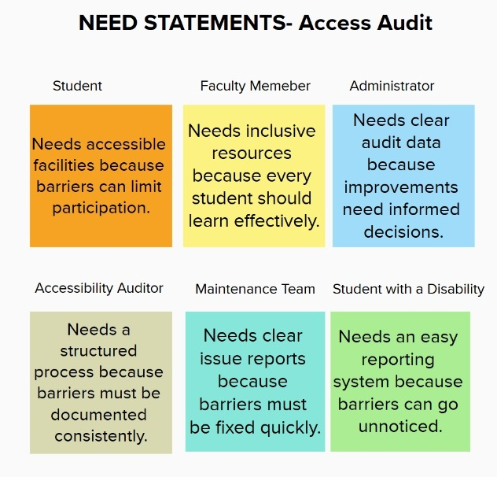
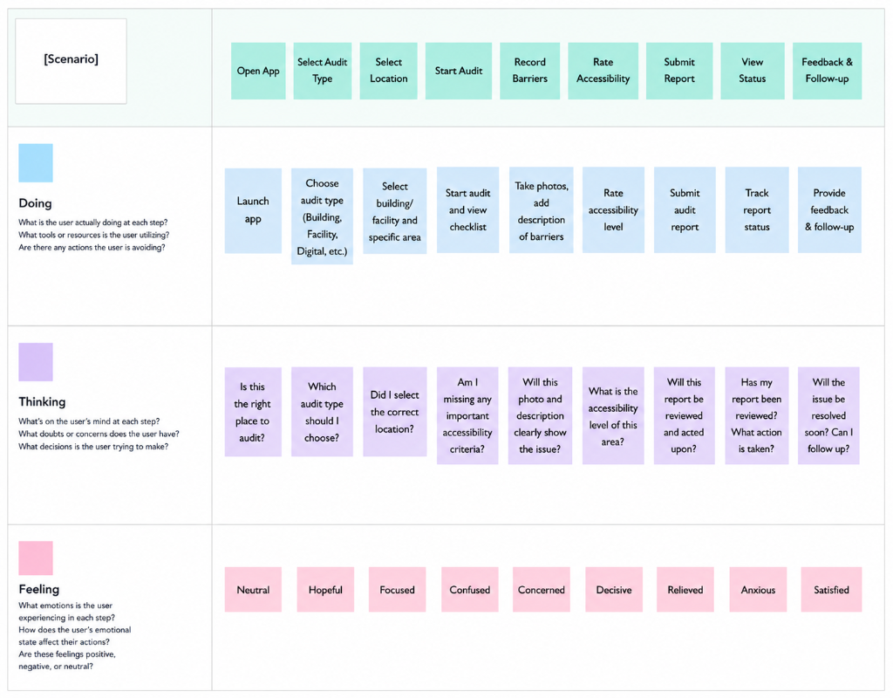
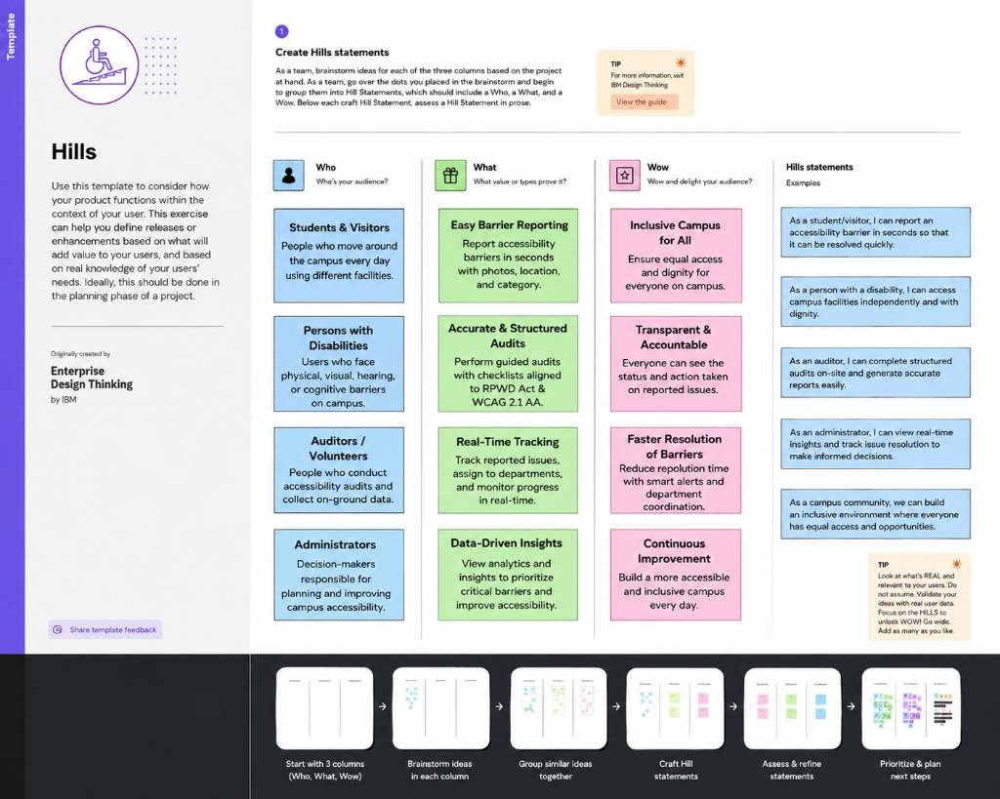
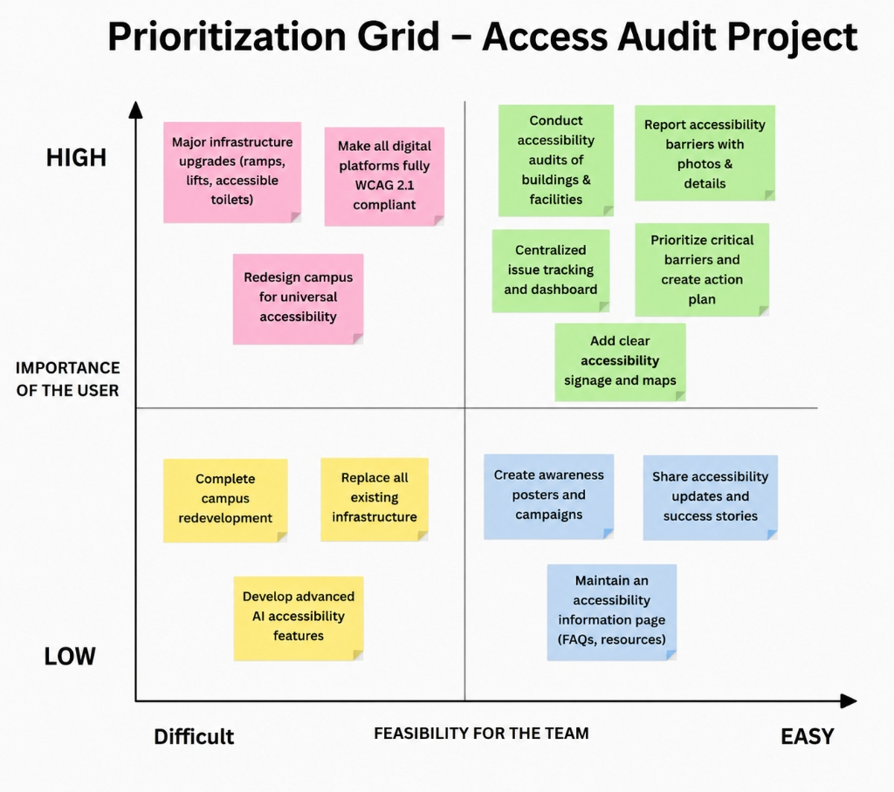
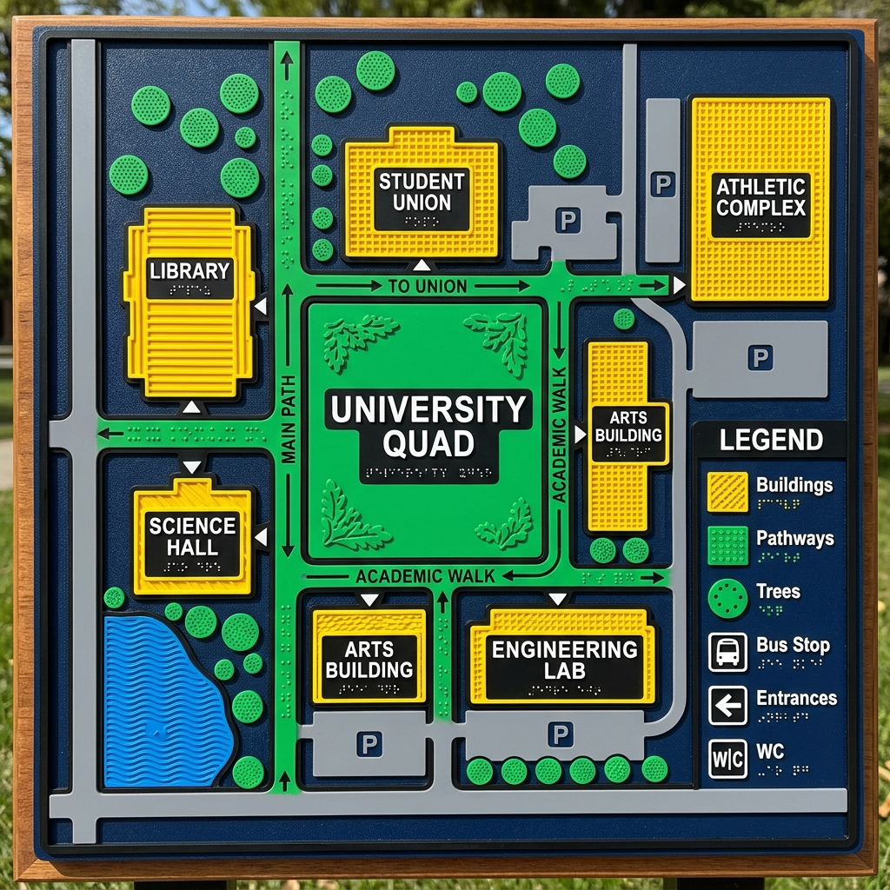

# 📸 AccessAudit Media & Field Evidence Gallery

> **Project Track:** S-06: Accessibility Audit & Inclusion Improvement Drive on Campus  
> **Host Organization:** C Square Club &bull; Chandigarh University (CUSoC 2026)  
> **Lead Researcher & Sole Contributor:** **Vaibhav Tiwari** (100% Individual Authorship)  
> **Mandatory Compliance Section:** CUSoC Contributor Guidelines **Section 19 (Field Work Evidence)**  

---

## 🏛️ Section 19: Mandatory Field Work Evidence & Community Engagement

In strict fulfillment of **Section 19 (Social Internship & Mandatory Field Engagement)** of the CUSoC 2026 Contributor Guidelines, this project is grounded in comprehensive in-situ physical fieldwork conducted across the Chandigarh University campus.

### Fieldwork Statistics & Verification
- **Survey Investigator:** Vaibhav Tiwari (Conducted 100% independently on-foot)
- **Campus Facilities Surveyed:** **29 Academic Buildings** (including A-Block, B-Block, C-Block, D-Block, NC-Block, Zakir Block, DD-Block, and Central University Library)
- **Metric Checkpoints Evaluated:** **1,102 Total Parameters**
- **Discovered Physical Barriers:** **187 Discrete Accessibility Obstacles** (cataloged into 4 severity tiers)
- **Campus Compliance Mean Index:** **68.2%**
- **Primary Raw Survey Dataset:** Published in [`../docs/Campus_Accessibility_Audit_Survey.xlsx`](../docs/Campus_Accessibility_Audit_Survey.xlsx)

---

## 🎨 Design Thinking Artifacts & Empathy Framework

The platform's features were designed using the **IBM Enterprise Design Thinking** methodology. All core artifacts are documented and visualized below:

### 1. Big Idea Vignettes ("What If" Explorations)

*Captures the initial divergent problem-solving questions: instant mobile barrier reporting, interactive step-free wheelchair routing, and automated CPWD compliance scoring.*

---

### 2. Stakeholder Need Statements

*Empathy analysis across 4 primary campus stakeholder groups: Students with Disabilities, Certified Campus Auditors, Facilities Maintenance Engineers, and University Administrators.*

---

### 3. User Journey Empathy Map (Doing, Thinking, Feeling)

*Maps the end-to-end emotional and practical experience of students reporting barriers and auditors conducting standardized inspections.*

---

### 4. Hills Statements (IBM Who / What / Wow Framework)

*Defines three measurable, human-centric success criteria governing platform engineering and impact.*

---

### 5. Prioritization Matrix Grid (Importance vs. Feasibility)

*2×2 decision framework ensuring high-impact features (42-checkpoint audit conductor, geotagged barrier reporting, 5-stage Kanban) were developed and deployed first.*

---

### 6. Tactile Campus Spatial Mapping

*Photographic reference of campus tactile pathway installations and physical wayfinding markers.*

---

## 🌐 Live Platform Screenshots & Interactive Demos

Experience the complete user interface live in production:
- **Interactive Geospatial Map (`/map`):** 29 building pins with wheelchair routing.
- **42-Parameter Audit Conductor (`/audits/conduct`):** Real-time weighted formula calculation with draft autosaving.
- **5-Stage Remediation Kanban (`/roadmap`):** Live ticket progression (`REPORTED` &rarr; `VERIFIED`).
- **Screen Reader Verbal Map (`/verbal-map`):** Accessible tabular directory for non-visual navigation.
- **Interactive Presentation Deck (`/presentation`):** 10 animated evaluation slides.

---

**Documented and Certified by:**  
**Vaibhav Tiwari**  
Sole Contributor & Full-Stack Cloud Developer, Track S-06  
Chandigarh University &bull; C Square Club &bull; CUSoC 2026
